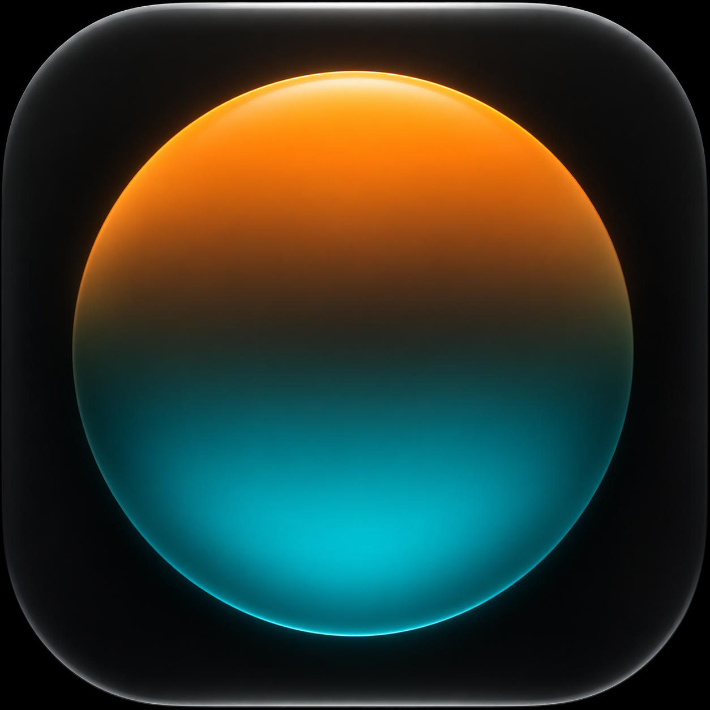
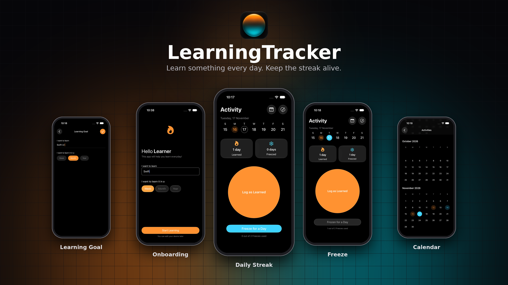

# LearningTracker

*Progress Over Perfection*

## Overview

LearningTracker is a native iOS app designed to help users build consistent learning habits by setting personal goals, tracking daily activities, and visualizing their progress.

## App Preview

## Key Features

- **Personalized Goals:** Set and edit weekly, monthly, or yearly learning goals.
- **Daily Tracking:** Record learning days or use limited Freeze days.
- **Progress Overview:** View daily activity, statistics, and learning history.
- **Goal Results:** Review outcomes and start a new learning goal.

## Technologies

- **Swift & SwiftUI:** Building a functional native iOS app.
- **Git & GitHub:** Managing source code and version control.
- **MVVM Architecture:** Organizing code into Models, Views, and ViewModels.
- **Swift Fundamentals:** Applying Optionals and data modeling with classes, structs, and enums.
- **Liquid Glass:** Adopting Apple's modern interface design.

## Project Context

Developed as part of the Hello World Challenge at Apple Developer Academy, focusing on Swift development, clean architecture, data modeling, GitHub collaboration tools, and Liquid Glass.
